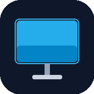

# 📱 Android Duo

<p align="center">
  
</p>

<p align="center">
  <strong>Второй дисплей и тачпад для macOS из любого Android-планшета</strong><br />
  Превратите ваш планшет (Xiaomi Redmi Pad SE, Pad 5/6/7, Samsung Galaxy Tab и др.) в высокоскоростной монитор для Mac с частотой <strong>90 Гц</strong>, ультранизкой задержкой <strong>2–5 мс</strong> и поддержкой мультитач-жестов.
</p>

<p align="center">
  <a href="https://www.apple.com/macos/"></a>
  <a href="https://android.com"></a>
  <a href="#"></a>
  <a href="#"></a>
  <a href="LICENSE"></a>
</p>

---

## 📖 Подробная документация
> 👉 **[Полная инструкция пользователя на русском языке (ИНСТРУКЦИЯ.md)](ИНСТРУКЦИЯ.md)**  
> Пошаговая настройка планшета, фиксация режима Host по Type-C, использование в киоске и браузере, решение проблем.

---

## ✨ Ключевые возможности

- ⚡ **Двухрежимная адаптивная частота:**
  - **По проводу (USB / ADB):** автоматическое переключение дисплея планшета на аппаратные **90.0 Гц (90 FPS)** с задержкой **2–5 мс**.
  - **По Wi-Fi:** автоматический переход на **60.0 Гц (60 FPS)** для экономии батареи и защиты от сетевого джиттера.
- 🔄 **Бесшовный Hot-Plug & Auto-Failover:**
  - Отсоединили провод — трансляция на лету подхватывается по Wi-Fi.
  - Подключили провод обратно — поток мгновенно возвращается на проводной USB без перезагрузки экрана и мерцания.
- 🚀 **Нативный Android-клиент (`Android Duo.apk`):**
  - Легковесное нативное приложение (20 КБ) без адресных строк браузера, без системных рамок и без лишних кнопок.
  - Аппаратное ускорение WebView и поддержка `singleTask` для мгновенного приёма команд с Mac.
- 🖥 **Нативное меню и дашборд macOS (`Android Duo.app`):**
  - Готовое приложение для macOS в строке меню: статус подключения, заряд батареи Mac и планшета, пинг и FPS в реальном времени.
  - Переключатель целевого клиента на планшете в 1 клик: **Native Client**, **Fully Kiosk Browser**, **WebAPK / Chrome PWA** или **Браузер**.
- 🎛 **Виртуальный дисплей HiDPI (1280×800 Retina @ 16:10):**
  - Пропорции идеально подогнаны под экраны планшетов без черных полос.
  - Возможность свободно двигать и позиционировать второй экран в *Системные настройки → Дисплеи*.
- 🎯 **Мультитач-жесты macOS:**
  - Плавный двухпальцевый скроллинг с инерцией.
  - Тап двумя пальцами / долгое удержание — правый клик (контекстное меню).
  - Щипок двумя пальцами — масштабирование (Pinch-to-zoom).
  - Перетаскивание окон и файлов (Drag & Drop).
- 🔄 **Портретный режим и автоповорот (Книжная ориентация):**
  - Поддержка гироскопа планшета: поверните планшет вертикально — виртуальный монитор macOS мгновенно перестраивается в портретный режим (800×1280, 900×1440, 1200×1920). По умолчанию установлена альбомная ориентация (Landscape). Идеально для программирования (100+ строк кода без скролла) и чтения документации.
- 📟 **Ретро-терминальный виджет DUO-HUD:**
  - Живая телеметрия в стиле Claude Code: CPU, RAM, интернет-трафик Mac, FPS и 3 датчика температуры (M2, процессор планшета и аккумулятор). Доступен по клику на плашку на планшете и прямо в строке меню macOS.
- 🔋 **Мониторинг батареи и энергоэффективность:**
  - Тихий опрос состояния батареи без назойливого звукового спама «Зарядка началась» на HyperOS / Android 15.
  - Отображение уровня заряда и статуса питания в Menu Bar и плавающей панели планшета.
- 🛡 **Защита от задержек (Zero Bufferbloat):**
  - Контроль очереди сокетов на уровне ядра (порог backpressure 32 КБ) полностью исключает лаги и всплески пинга при резком движении окон.

---

## 📟 Виджет DUO-HUD: Живой монитор железа в стиле Claude Code

Прямо во время работы на планшете вы можете мгновенно вызвать компактный терминальный виджет **DUO-HUD**, вдохновленный эстетикой CLI Claude Code. Он показывает полную телеметрию системы без переключения окон.

```text
╭─ DUO-HUD                                           ● LIVE [✕] ─╮
│ CPU  [████░░░░] 21%                                   Apple M2 │
│ RAM  [██████░░] 5.9 / 8.0 GB                               73% │
│ NET  [██░░░░░░] 0.5 MB/s                                90 FPS │
│ TMP  M2: 44°C · Pad: 41°C · Bat: 32°C                          │
│ PWR  Mac: 68%⚡ · Pad: 100%⚡                              LIVE │
╰────────────────────────────────────────────────────────────────╯
```

### 🎯 Интерактивная раздельная плашка (Split Floating Pill)

Верхний плавающий индикатор на планшете невидимо разделён на **две независимые функциональные зоны**:

```text
 ┌────────────────────────────────────────────────────────┐
 │           Интерактивная плашка (Floating Pill)         │
 ├────────────────────────────┬───────────────────────────┤
 │     Левая половина         │      Правая половина      │
 │    [ ● LIVE  ⚡ USB ]       │   [ 100% ⚡ · ⚙️ Меню ]   │
 ├────────────────────────────┼───────────────────────────┤
 │             ↓              │             ↓             │
 │  Вызов виджета DUO-HUD     │  Панель полных настроек   │
 │   (терминальный монитор)   │  (FPS, масштаб, поворот)  │
 └────────────────────────────┴───────────────────────────┘
```

- **Тап в левую часть плашки:** мгновенно раскрывает компактное окно **DUO-HUD**. Направление открытия подстраивается автоматически: если плашка сверху — выпадает вниз, если снизу — всплывает вверх.
- **Тап в правую часть плашки:** открывает панель настроек экрана (масштаб интерфейса, режим 90/60 FPS, ориентация, режим заполнения).
- **Перетаскивание в любую сторону:** зажмите плашку и перенесите в любое из 6 удобных мест (верх/низ, лево/центр/право). Положение запоминается.

### 📊 Отображаемые параметры телеметрии

| Параметр | Что измеряет | Источник данных |
|---|---|---|
| **`CPU`** | Нагрузка процессора Apple Silicon с пиксельным ASCII-баром `[████░░░░]` | Ядро Darwin macOS (`mach_host_processor_info`) |
| **`RAM`** | Занятая и общая оперативная память Mac в гигабайтах и процентах | Системный счетчик виртуальной памяти macOS (`vm_stat`) |
| **`NET`** | Реальная входящая/исходящая скорость интернет-трафика Mac + FPS потока | Системный счетчик сетевых интерфейсов `netstat -ibn` |
| **`TMP`** | **Сразу 3 датчика температуры:** чип Mac (`M2`), процессор планшета (`Pad`) и батарея (`Bat`) | Аппаратный SMC macOS (`mac_temp`) + термозоны ядра Linux Android |
| **`PWR`** | Точный заряд аккумуляторов MacBook и планшета со статусом зарядки `⚡` | Apple Smart Battery subsystem + Android BatteryManager via ADB |

> 💡 **Также доступен на Mac:** виджет встроен прямо в статусное меню macOS (Menu Bar) и всегда доступен по клику на иконку Android Duo в верхнем баре Mac.

---

## 📊 Сравнение способов отображения на планшете

| Клиент | Способ запуска | Плюсы |
|---|---|---|
| **Android Duo APK** *(Рекомендуется)* | Установка `Android Duo.apk` на планшет | Чистый экран без рамок, максимальная производительность, автозапуск с Mac по кабелю |
| **Fully Kiosk Browser** | Приложение из Google Play / сайта | Полная блокировка системных кнопок и шторки Android (режим киоска) |
| **Chrome / Браузер / PWA** | Открытие `http://<IP-Mac>:3000` | Работает на любых устройствах без установки APK, можно добавить как иконку PWA на рабочий стол |

---

## 🚀 Быстрый старт

### 1. Скачивание и запуск на Mac
1. Скачайте **`Android Duo.dmg`** или склонируйте репозиторий:
   ```bash
   git clone https://github.com/daniel1134i/android-duo.git
   cd android-duo
   ```
2. Откройте **Android Duo.app** (или запустите `./start.command` / `./start.sh`).
3. При первом запуске разрешите **«Запись экрана»** в *Системные настройки → Конфиденциальность и безопасность*.

### 2. Подключение планшета
1. Включите **«Отладку по USB»** в настройках разработчика планшета.
2. В пункте **«Конфигурация USB по умолчанию»** выберите **«Передача файлов»** (чтобы зафиксировать Mac как Host).
3. Подключите планшет кабелем Type-C к Mac — дисплей активируется автоматически на **⚡ 90 FPS**!

---

## 🛠 Установка APK на планшет

Установочный файл **`Android Duo.apk`** находится в корне репозитория.

Установка в одну команду по кабелю:
```bash
adb install -r "Android Duo.apk"
```
*(Или скопируйте `Android Duo.apk` в память планшета и установите через стандартный проводник).*

---

## 🎛 Сенсорные жесты

| Действие | Жест на планшете |
|---|---|
| **Перемещение мыши** | Ведение одним пальцем |
| **Левый клик (ЛКМ)** | Одиночное касание |
| **Правый клик (ПКМ)** | Касание двумя пальцами одновременно или долгое удержание |
| **Прокрутка (Scroll)** | Скольжение двумя пальцами вверх / вниз |
| **Масштабирование** | Щипок двумя пальцами (Pinch-to-zoom) |
| **Перетаскивание (Drag)** | Двойное касание с удержанием и ведением |
| **Виджет DUO-HUD** | Нажатие на левую половину плашки (Pill) |
| **Панель настроек** | Нажатие на правую половину плашки (Pill) |
| **Перемещение плашки** | Зажатие и перетаскивание плашки в любую сторону |

---

## 📁 Структура репозитория

```text
android-duo/
├── Android Duo.app/         # Скомпилированное приложение macOS (Menu Bar + Dashboard)
├── Android Duo.dmg          # Готовый DMG-образ для быстрой установки на Mac
├── Android Duo.apk          # Готовый клиент для Android-планшетов
├── android-client/          # Исходный код нативного Android-приложения (Java + Android SDK)
│   ├── src/                 # MainActivity.java с аппаратным ускорением и onNewIntent
│   └── build.sh             # Автоматический скрипт сборки APK через aapt2, d8, apksigner
├── macos-app/               # Исходный код приложения строки меню для macOS (SwiftUI)
│   ├── main.swift           # Дашборд, переключатель клиентов, телеметрия
│   ├── build.sh             # Скрипт сборки .app бандла
│   └── build-dmg.sh         # Скрипт создания DMG-образа
├── native/                  # Высокоскоростной движок захвата и виртуального дисплея
│   ├── virtual_display.m    # Создание виртуального монитора HiDPI (Metal / IOKit)
│   └── mac_host.swift       # ScreenCaptureKit захват и синтез жестов CoreGraphics
├── server/
│   └── index.js             # Node.js сервер, ADB watcher, WebSocket брокер, backpressure
├── public/                  # Веб-клиент для браузеров и PWA (HTML5, Canvas, WebCodecs)
├── ИНСТРУКЦИЯ.md            # Подробное пошаговое руководство пользователя
└── start.command            # Быстрый запуск в один клик из Finder
```

---

## 📄 Лицензия

Распространяется под лицензией **MIT**. Подробности в файле [LICENSE](LICENSE).
